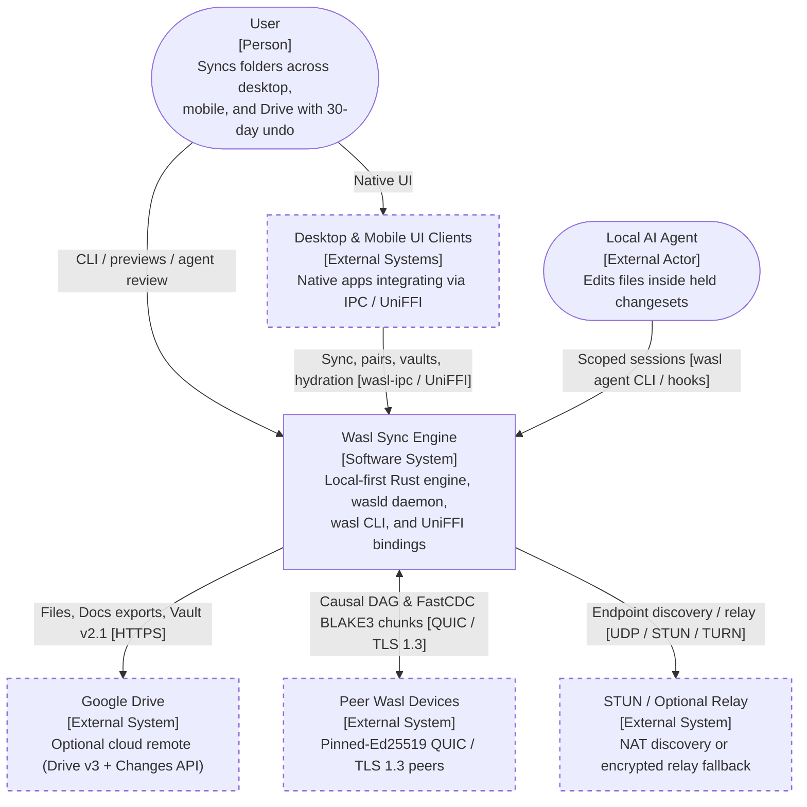
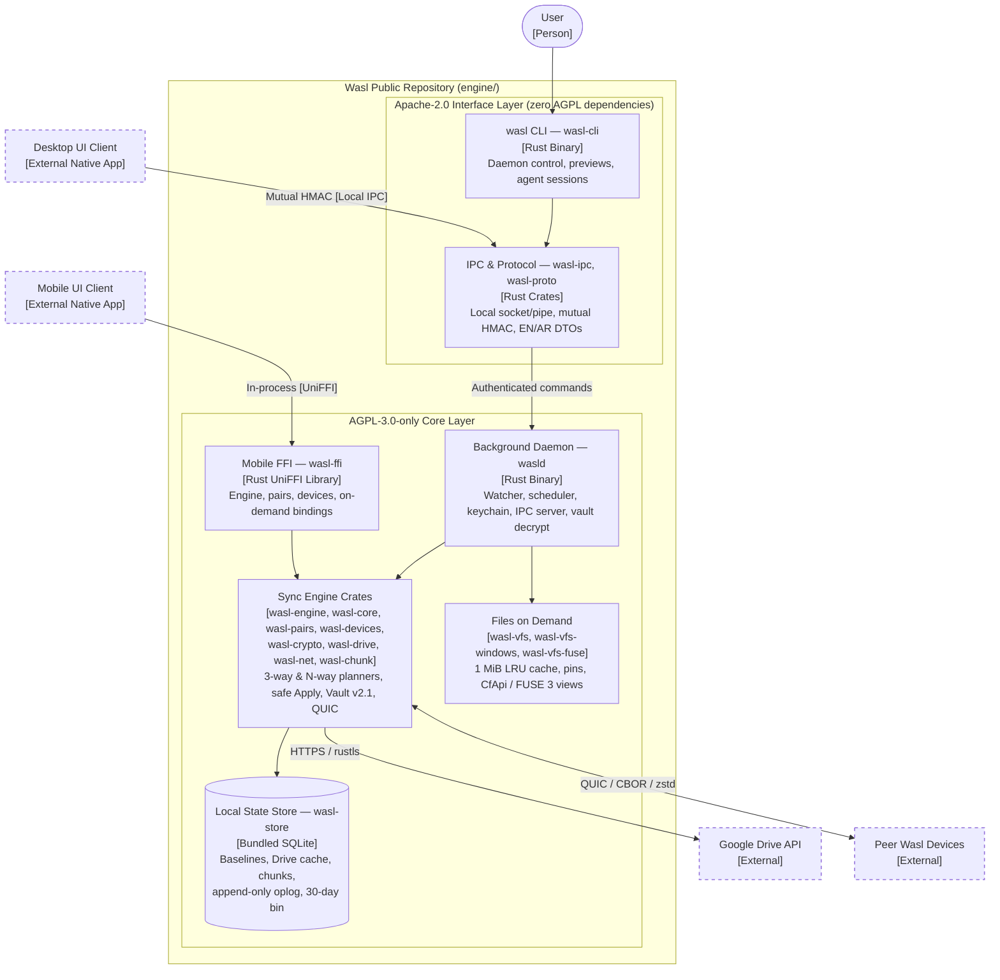
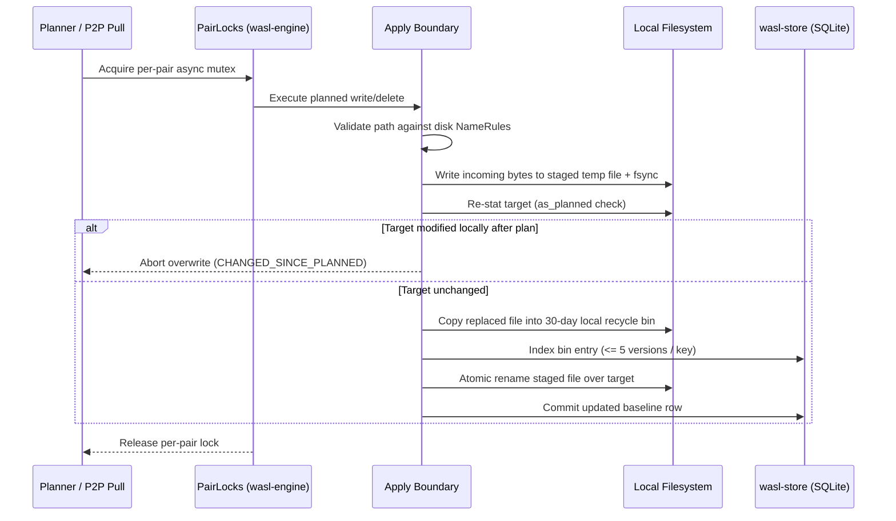
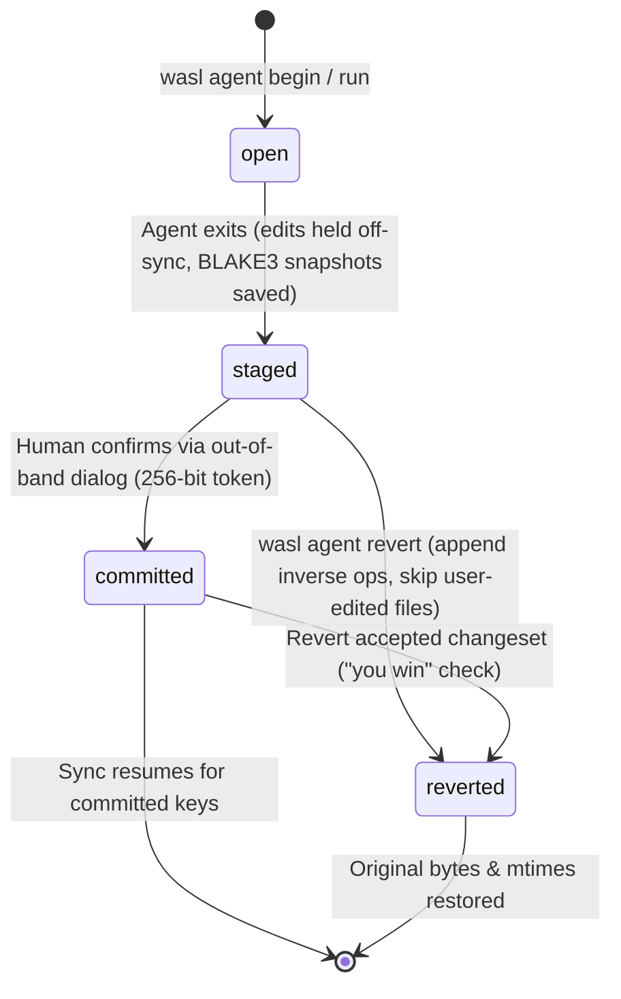
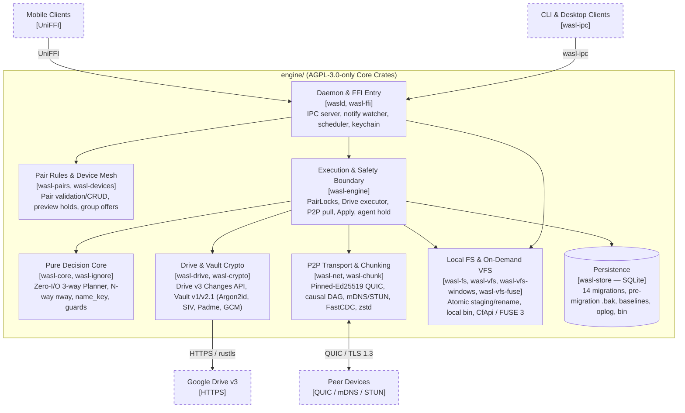

# Wasl

Wasl is a local-first Rust folder synchronization engine (`wasl-core` / `wasld` / `wasl` CLI / UniFFI bindings) that syncs folders across Linux, macOS, Windows, Android, and Google Drive—with direct peer-to-peer QUIC sync, optional client-side encrypted vaults, crash-safe file replacement, 30-day undo, and held changesets for AI agents.

Every sync decision, conflict rule, safety guard, cryptographic format, and error sentence lives in a single 19-crate Rust workspace (`engine/`) with `unsafe_code = "forbid"` everywhere except the Windows Cloud Files FFI wrapper (`wasl-vfs-windows`) and `clippy::unwrap_used = "deny"` enforced on every shipping crate root.

---

## Architecture & Sync Design Tradeoffs

### System Context (C4 Level 1)



### Containers & Open-Core Boundary (C4 Level 2)



### Runtime Safety: Crash-Safe Apply & Agent Changeset Lifecycle (UML)





<details>
<summary>Level 3 — Component Diagram: Rust Sync Engine Workspace (19 Crates)</summary>



</details>

Full component map and module boundaries: [`docs/ARCHITECTURE.md`](docs/ARCHITECTURE.md).

### Key design decisions and tradeoffs

| Design decision | Why we chose it | Tradeoff we explicitly accepted |
|---|---|---|
| **Pure-function planner with lazy hashing** (`wasl-core::Planner`) | Planning takes `(baseline, local, remote)` in memory and returns `NeedHashes(paths)` only for files whose `(size, mtime)` drifted. Zero I/O in decision logic gives exact dry-run previews, deterministic property tests (2,000 cases per invariant), and ~209 ms planning for 100k keys. | Peak memory scales with folder entry count during planning, and a single slow stat/list delays plan start compared to streaming sync. |
| **Dual sync models: 3-way baseline (Drive) vs N-way Version Vectors (P2P)** | Google Drive has no CAS or vector clock natively, while P2P must converge across arbitrary N-device topologies and offline partitions using 90-day tombstones (`wasl-core::nway`). Both share one per-pair lock (`PairLocks`) and one apply boundary. | Maintaining two planners instead of one. Hybrid `drive_and_devices` pairs currently run both sequentially and converge via BLAKE3 content identity, which can transfer a newly edited file twice on its first hop before Drive native `wasl.vv` metadata is enabled. |
| **Two-tier FastCDC + BLAKE3 (`wasl-chunk`) + adaptive per-chunk zstd (`wasl-net`)** | Files ≤ 16 MiB use `16/64/256 KiB` chunks; files > 16 MiB use `1/4/16 MiB` chunks (`fastcdc = 3.2.1` pinned so cut points stay identical across peers). Chunk IDs hash *uncompressed* bytes, keeping deduplication and resume independent of zstd level. Sender compression is capped at 2 concurrent slots and skips incompressible chunks. | Delta size is probabilistic, not worst-case bounded on adversarial or all-zero streams. Under bursty loopback loads with 8 small chunks in flight, slow compression levels (e.g. metered level 9) spill past the 2-slot CPU cap to raw chunks rather than letting peers saturate sender CPU (see benchmark notes below). |
| **Single crash-safe apply boundary (`wasl-engine::apply`)** | Every overwrite runs `stage → fsync → re-stat vs plan → copy old file to recycle bin + SQLite index → atomic rename → commit baseline`. Verified by a deterministic kill-point harness (`tests/killpoints.rs`) that halts execution at every step and asserts zero silent data loss on restart. | Per-file `fsync` + bin copy caps small-file throughput (~186 files/s on NTFS) compared to buffered in-place writes. We chose crash-consistency and recoverability over raw small-file speed. |
| **Uniform cross-OS name identity (`Unicode NFC + lowercase`, [ADR-0004](docs/adr/0004-name-identity.md))** | Windows (NTFS), macOS (APFS), and Android fold case/normalization while Linux and Drive do not. Folding every segment to one `name_key` everywhere eliminates cross-OS silent overwrites and phantom deletes; same-side collisions become explicit *name clashes* left untouched until renamed. | Linux peers cannot sync `Notes.txt` and `notes.txt` inside the same folder; one must be renamed. |
| **Vault v2.1: keyed FastCDC + Padmé padding + AES-256-GCM bound to `(file_id, chunk_id)`** | Binding chunk AAD to `(file_id, chunk_id)` rather than chunk index lets a mid-file insertion re-upload only changed chunks (~4% for a 1 MiB edit in 64 MiB) and enables `O(1)` random-access range reads (`0.80 ms` seek at 48 MiB). Keyed gear tables + Padmé buckets hide exact file/chunk lengths (+1.19% overhead), and per-writer MACed records detect whole-folder rollbacks. | Directory tree shape, file counts, and padded size buckets remain visible to Drive; chunk ordering is authenticated by the encrypted per-file manifest rather than chunk-index AAD ([docs/ON_DEMAND.md](docs/ON_DEMAND.md), [docs/ENCRYPTION.md](docs/ENCRYPTION.md)). |
| **Pinned-Ed25519 QUIC/TLS 1.3 + signed causal group DAG (`wasl-net`)** | Zero central servers or certificate authorities; mDNS advertises only a random per-boot token so identity is revealed only after pinned TLS 1.3 verification. Concurrent device removals fail closed (both leave) with post-signature per-signer rate limiting. | A removed device that has not yet been observed as removed by an offline peer can force a re-pair of that peer (never gain membership). Strict symmetric NATs where UDP hole punching fails require a self-hosted or managed relay ([docs/DEVICE_SYNC.md](docs/DEVICE_SYNC.md)). |
| **Decoupled open-core boundary (`AGPL-3.0-only` vs `Apache-2.0`)** | `wasl-proto`, `wasl-ipc`, and `wasl-cli` carry zero AGPL dependencies (enforced in CI by `check-license-boundaries.py`), letting scripts and external tools integrate over local IPC without copyleft obligations while keeping the core engine and relay auditable under AGPL. | Cross-process IPC serialization and out-of-process invocation (`wasld vault decrypt`) add minor boundary boilerplate compared to a single monolithic binary ([docs/OPEN_MODEL.md](docs/OPEN_MODEL.md)). |

---

## Conflict Handling & Data Safety Model

### 1. Google Drive pairs (three-way merge, `wasl-core::planner`)
- **Identical edits adopt silently:** if both sides modified a file to the exact same content (size + MD5), Wasl records the baseline without creating a conflict copy.
- **Divergent edits:** default policy `KeepBoth` renames the local version to `name (conflicted copy from <device>, YYYY-MM-DD HH-MM).ext` (numbered on collision) and downloads Drive's copy—both versions survive. Also supports `LocalWins`, `RemoteWins`, `NewerWins`, and `Skip`.
- **Edit vs. delete:** an edit always beats a delete (a file modified on Drive after local deletion is restored rather than lost; a folder deleted on Drive while new files exist locally is recreated on Drive).

### 2. Peer-to-peer pairs (N-way version vectors, `wasl-core::nway`)
- **Causal ordering:** each key carries a `VersionVector` (`ShortId → counter`). If one vector dominates, the newer version replaces the older one (edit, move, or 90-day tombstone delete).
- **Concurrent identical content:** both peers emit `Step::Adopt` (element-wise max vector, canonical `(mtime, author)`) with zero conflict copies.
- **Concurrent divergent content & the loser-resolves-only invariant:**
  - Every peer computes the exact same total order: `edit beats delete → newer mtime → higher author ShortId → larger BLAKE3`.
  - **Crucial invariant (verified by 3-device property tests in `wasl-core/tests/nway.rs`):** *only the peer holding the losing version resolves the conflict*. The losing peer moves its content to `stem (conflict <author4> <blake3_8>).ext` (under `KeepBoth`, or to the recycle bin under `NewestWins`), installs the winner, and advances to the merged version vector. The winning peer does nothing until the merged vector propagates back. If the winning peer merged immediately, its merged vector would dominate the loser's version on a third peer, causing that third peer to discard the losing content without saving a conflict copy.
  - Equal vectors with differing content (from racing resolutions) are repaired deterministically by content hash alone so all peers still converge.

### 3. Safety rails active by default
- **Preview hold:** every newly created pair refuses automated or manual sync until the user reviews the initial dry-run plan and starts it.
- **Mass-delete & first-merge guards (`wasl-core::guards`):** automatically halt any run that would delete `> 20` files or `> 5%` of a side (for batches `≥ 5` files), or merge two non-empty folders for the first time, until explicitly approved once.
- **Re-check before write (`CHANGED_SINCE_PLANNED`):** `Apply::as_planned` re-stats every target file right before replacement or deletion; if the file changed after planning, the action is deferred untouched.
- **30-day two-sided recycle bin:** local overwrites and deletes move to Wasl's indexed local bin (30 days, up to 5 versions per key); Drive deletes move to Drive's trash.
- **AI agent changeset hold & append-only op-log ([ADR-0002](docs/adr/0002-one-op-log.md), [docs/AGENT_CHANGES.md](docs/AGENT_CHANGES.md)):** edits made inside `wasl agent run` / hooks are held off-sync with BLAKE3-verified pre-edit backups; revert appends inverse ops without overwriting post-session user edits ("you win"), and accept requires out-of-band human confirmation.

---

## Measured Throughput & Latency Benchmarks

Measured on **Windows 11 (`x86_64`), AMD Ryzen 7 9700X (8C/16T, 32 GB RAM), `rustc 1.99.1`, `--release` (`lto = "thin"`, `codegen-units = 1`)** using deterministic synthetic workloads.

Reproduce on your own machine with one command:

```sh
cd engine
cargo run --release -p wasl-engine --example bench
```

### Core planner, chunking, and Vault v2.1 cryptography

| Subsystem | Workload | Measured latency / wire | Measured throughput / ratio |
|---|---|---:|---:|
| Three-way Drive planner (`wasl-core`) | 100,000 keys (2% changed) | **209.1 ms** | **478k keys/s** (2,000 uploads; NFR budget 2,000 ms) |
| N-way version-vector planner (`wasl-core::nway`) | 100,000 keys (2% changed) | **24.9 ms** | **4.01M keys/s** (2,000 steps) |
| FastCDC + BLAKE3 medium tier (`wasl-chunk`) | 16 MiB (`16/64/256 KiB`) | **9.0 ms** | **1,777 MiB/s** (201 chunks) |
| FastCDC + BLAKE3 large tier (`wasl-chunk`) | 64 MiB (`1/4/16 MiB`) | **34.2 ms** | **1,869 MiB/s** (13 chunks) |
| FastCDC delta (4 KiB edit in 10 MiB, medium tier) | 10 MiB file | **100.1 KiB** fetched | **0.98%** of file (1 chunk) |
| FastCDC delta (1 MiB edit in 64 MiB, large tier) | 64 MiB file | **5.38 MiB** fetched | **8.40%** of file (2 chunks) |
| Vault v2.1 encrypt (`wasl-crypto`, keyed CDC + Padmé + AES-256-GCM) | 64 MiB (51 chunks) | **77.3 ms** | **828 MiB/s** (+1.19% ciphertext/pad overhead) |
| Vault v2.1 decrypt + whole-file BLAKE3 verify | 64 MiB | **67.6 ms** | **946 MiB/s** |
| Vault v2.1 random-access range read (`64 KiB` @ `48 MiB` offset) | 64 MiB file | **0.80 ms** | **1 / 51 chunks** fetched (0.78 MiB) |
| Vault v2.1 delta update (`1 MiB` mid-file edit) | 64 MiB file | **2.76 MiB** to upload | **4.31%** of file (2 new chunks) |

### End-to-end P2P sync over QUIC + TLS 1.3 (loopback, full disk + SQLite)

Includes local filesystem scan, FastCDC chunk indexing, pinned-Ed25519 QUIC/TLS 1.3 transport, crash-safe `Apply` (`fsync` + atomic rename), and SQLite baseline persistence on both peers:

| Workload | Payload | Wall time | Effective throughput / wire efficiency |
|---|---|---:|---|
| Local scan + FastCDC chunk index (`wasl-engine`) | 62.5 MiB (80 mixed files) | **81.7 ms** | **765 MiB/s** |
| P2P QUIC initial sync — raw (level 0) | 62.5 MiB (75% text, 25% incompressible) | **1,457 ms** | **43 MiB/s** payload · 62.5 MiB wire (100.0%) |
| P2P QUIC initial sync — LAN (zstd level 1) | 62.5 MiB (75% text, 25% incompressible) | **1,459 ms** | **43 MiB/s** payload · **39.8 MiB wire (63.7%)** |
| P2P QUIC initial sync — internet (zstd level 3) | 62.5 MiB (75% text, 25% incompressible) | **1,535 ms** | **41 MiB/s** payload · 41.4 MiB wire (66.2%) |
| P2P QUIC initial sync — metered (zstd level 9) | 62.5 MiB (75% text, 25% incompressible) | **1,472 ms** | **42 MiB/s** payload · 48.5 MiB wire (77.6%)* |
| P2P QUIC incremental delta (`4 × 4 KiB` edits in `32 MiB`) | 32 MiB modified files | **103.5 ms** | **384.6 KiB** raw → **79.2 KiB wire (0.24% of whole files)** |
| P2P QUIC small-file sync (`fsync` + atomic rename + SQLite) | 1,000 × 4 KiB files (4 MiB) | **5,391 ms** | **186 files/s** |

\* *Why level 9 sends more wire bytes than level 1 on loopback:* by design (`docs/COMPRESSION.md` §2), a sender limits concurrent zstd compressions to **2 slots** and falls back to sending raw chunks whenever both slots are busy so a peer cannot starve sender CPU. On loopback with 8 concurrent chunk requests, level-9 compression occupies those 2 slots longer and spills more chunks to raw. On real WAN/metered links where network RTT paces requests, compression stays inside the 2-slot budget and shrinks real workspace trees to ~51–52% of raw bytes (299.6 MB at metered level 9 and 307.5 MB at internet level 3 vs 589.6 MB raw across 6,540 files in [`docs/COMPRESSION.md`](docs/COMPRESSION.md)).

---

## Install & Quick Start

### Pre-compiled binaries (GitHub Releases)
Download the archive for your platform (`x86_64`/`aarch64` Linux, `aarch64`/`x86_64` macOS, `x86_64` Windows) from [GitHub Releases](https://github.com/Ahmad-AlModhayan/wasl/releases), verify against `SHA256SUMS.txt`, and place `wasl` and `wasld` on your `PATH`.

To package a release archive locally for your current host target:

```sh
python3 engine/scripts/package-release.py
```

### Build from source
Requires the pinned Rust toolchain (`engine/rust-toolchain.toml`) and a C compiler for bundled SQLite (`wasl-store`):

```sh
cd engine
cargo build --release -p wasld --bin wasld -p wasl-cli --bin wasl
```

### CLI quick start

```sh
# 1. Start the background daemon (or install it as a login service via `wasl service install`)
wasl daemon start

# 2. Pair a local folder with Google Drive (optional: `wasl account add` first)
wasl pair add ~/Documents "My Drive/Documents" --method two-way --gitignore

# 3. Inspect the dry-run plan and start the initial sync (clears the preview hold)
wasl pair preview Documents --start

# 4. Share a folder directly with another device over P2P QUIC
wasl pair share Documents          # prints a share code / sends an offer
wasl status                        # shows folder states and peer reachability

# 5. Hold AI agent edits off-sync until reviewed
wasl agent run --as claude-code -- claude
wasl agent list
wasl agent show <id> --diff
wasl agent revert <id>             # or accept via confirmation dialog
```

---

## Verification & Quality Gates

Every change passes the full local/CI verification suite (`engine/`):

```sh
cd engine
cargo fmt --all --check
python3 scripts/check-license-boundaries.py
cargo clippy --workspace --all-targets -- -D warnings
cargo clippy --workspace --lib --bins --examples -- -D warnings -D clippy::unwrap_used
cargo test --workspace
cargo test -p wasl-ffi --all-features
cargo test -p wasl-engine --test killpoints
```

- **Crash-recovery tests:** `wasl-engine/tests/killpoints.rs` stops and restarts runs at every stage of `Apply`.
- **Property tests:** `wasl-core/tests/properties.rs` (2,000 generated cases per invariant) and `wasl-core/tests/nway.rs` (3-device arbitrary interleaving convergence).
- **Adversarial parser robustness & fuzzing:** `tests/robustness.rs` across `wasl-net`, `wasl-crypto`, `wasl-chunk`, `wasl-drive`, `wasl-ipc`, plus `cargo-fuzz` targets under `engine/fuzz/`.
- **Supply-chain checks:** `tools/security-check.sh` runs `cargo audit` and `cargo deny` (`engine/deny.toml`) across all desktop, mobile, and server targets.

---

## Repository Layout & Open-Core Licensing

Wasl uses a **decoupled open-core** model ([`docs/OPEN_MODEL.md`](docs/OPEN_MODEL.md)). Official native Android and desktop UI apps talk to the engine strictly across the FFI/IPC boundary and live outside this repository.

| Path / Crates | What it is | Licence |
|---|---|---|
| `engine/crates/wasl-proto`, `wasl-ipc`, `wasl-cli` | Wire DTOs, authenticated local IPC transport, thin `wasl` CLI (zero AGPL dependencies, verified in CI) | [Apache-2.0](LICENSE-APACHE) |
| `engine/crates/wasl-core`, `wasl-engine`, `wasl-store`, `wasl-crypto`, `wasl-net`, `wasl-devices`, `wasl-drive`, `wasl-fs`, `wasl-ignore`, `wasl-pairs`, `wasl-chunk`, `wasl-vfs*`, `wasl-ffi`, `wasld` | Sync engine, background daemon (`wasld`), UniFFI bindings, self-hostable core | [AGPL-3.0-only](LICENSE) (commercial dual-licence available from Kahf Labs) |
| [`tools/`](tools/) | Independent Python vault recovery script (`decrypt_vault.py`), dependency security gate, Miqyas harness scripts | [AGPL-3.0-only](LICENSE) |
| [`docs/`](docs/) | Architecture, ADRs 0001–0004, crypto & P2P protocol specs, security audit log, user guide | See [LICENSE](LICENSE) |

### Documentation index

[ARCHITECTURE](docs/ARCHITECTURE.md) · [OPEN_MODEL](docs/OPEN_MODEL.md) · [DEVICE_SYNC](docs/DEVICE_SYNC.md) · [ENCRYPTION](docs/ENCRYPTION.md) · [COMPRESSION](docs/COMPRESSION.md) · [ON_DEMAND](docs/ON_DEMAND.md) · [AGENT_CHANGES](docs/AGENT_CHANGES.md) · [ERRORS](docs/ERRORS.md) · [SECURITY](docs/SECURITY.md) · [SETUP](docs/SETUP.md) · [USER_GUIDE](docs/USER_GUIDE.md) · [ADRs](docs/adr/)

Contributions require a one-time [CLA](CLA.md) (contributors keep copyright); see [CONTRIBUTING.md](CONTRIBUTING.md). Forks may not use the Kahf or Wasl names or logos ([TRADEMARKS.md](TRADEMARKS.md)). Report security vulnerabilities privately ([SECURITY.md](SECURITY.md)), and review third-party notices in [NOTICE.md](NOTICE.md) and [THIRD_PARTY_NOTICES.md](THIRD_PARTY_NOTICES.md).
